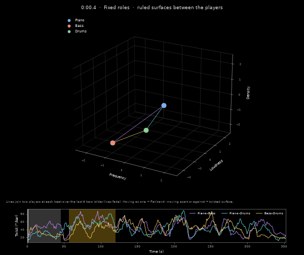

# formalized-interplay

Code for Liberal Arts Final Report, Institute of Science Tokyo, 2026.

Target recording: Bill Evans Trio, "Autumn Leaves", *Portrait in Jazz* (Riverside, 1959), album master take.



## Background

The analysis adapts two ideas of Iannis Xenakis from *Formalized Music* to a recorded performance:

- **Screen.** Xenakis writes any sound as a function s(F, G, D, t) of frequency, intensity, density and time, and places grains of sound within each time slice Δt on a frequency × intensity grid (the screen). Here each player at each beat is one point in a space of frequency, loudness and density, restoring the density axis; the beat plays the role of Δt.
- **Ruled surface.** In *Metastaseis* (1953–54) string glissandi are straight lines on the pitch–time plane, and their bundle forms a ruled surface, a shape Xenakis later used for the Philips Pavilion (1958). Here the line joins two players at each beat and is drawn in the screen space rather than along a time axis. Players moving alike give a flat surface; one moving and the other following late twists it.

## Requirements

- Python 3.12, [uv](https://docs.astral.sh/uv/)
- ffmpeg
- The recording, not included: audio, separated stems and note-level data (`audio/`, `separated/`, `work/`, `data/`) are not distributed for copyright reasons. We used the iTunes Store release (AAC, 6:02). Put it at `audio/autumn_leaves.m4a`.

```sh
uv sync
```

Dependencies are pinned in `uv.lock`. Tested on macOS (Apple silicon) with CPU only.

## Usage

```sh
uv run python -m interplay              # all steps of the paper (separation takes about 30 min on CPU)
uv run python -m interplay figures      # one step, from the files the previous step wrote
```

| Step | | Output |
|---|---|---|
| `separate` | source separation (Demucs `htdemucs_ft`, seed 0) | `separated/merged/{piano,bass,drums}.wav` |
| `transcribe` | piano transcription | `data/piano_notes.csv` |
| `grains` | beats per part (`beats.py`) and note/onset events | `data/beats.csv`, `data/grains_*.csv` |
| `screen-space` | per-beat positions of each player | `data/screen_space.csv` |
| `ruled` | twist of each pair | `data/ruled.csv` |
| `figures` | Fig. 1 to Fig. 3 | `figures/fig1_trajectories.png`, `figures/fig2_distribution.png`, `figures/fig3_ruled_surfaces.png` |
| `animation` | ruled-surface GIF (not in the paper) | `figures/ruled.gif` |

`transcribe` downloads the pretrained weights from Zenodo to `models/` and checks their SHA-256.

## Sections

Parts and sections are set in `interplay/config.py` (times of the iTunes release). Beats are tracked separately in each part (intro, theme, bass solo, interplay, rest) and aligned to the onsets of the instruments that keep time there; beats within 1.2 s of a part boundary are left out of the comparison. The compared sections are fixed roles 0:00–0:45.37 and interplay 0:56.77–2:00.08. Each figure shows the middle 16 bars of each section. `ruled` prints the mean twist per section.

## References

- I. Xenakis. *Formalized Music: Thought and Mathematics in Composition*. Japanese translation: 野々村禎彦 監訳, 冨永星 訳『形式化された音楽』, 筑摩書房, 2017 (screen: pp. 55, 62–64; *Metastaseis* and the Philips Pavilion: pp. 11–17).

## Acknowledgements

- Demucs (MIT). S. Rouard, F. Massa, A. Défossez. Hybrid Transformers for Music Source Separation. ICASSP 2023.
- piano_transcription_inference (MIT); pretrained weights CC BY 4.0, [Zenodo 4034264](https://zenodo.org/records/4034264). Q. Kong, B. Li, X. Song, Y. Wan, Y. Wang. High-resolution Piano Transcription with Pedals by Regressing Onset and Offset Times. IEEE/ACM TASLP 29, 2021.
- librosa (ISC).

## License

MIT
